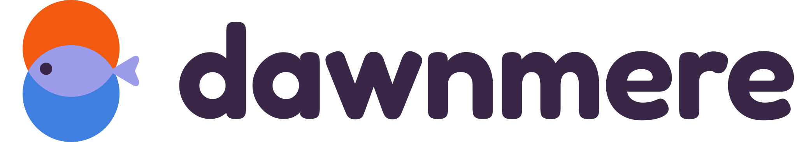
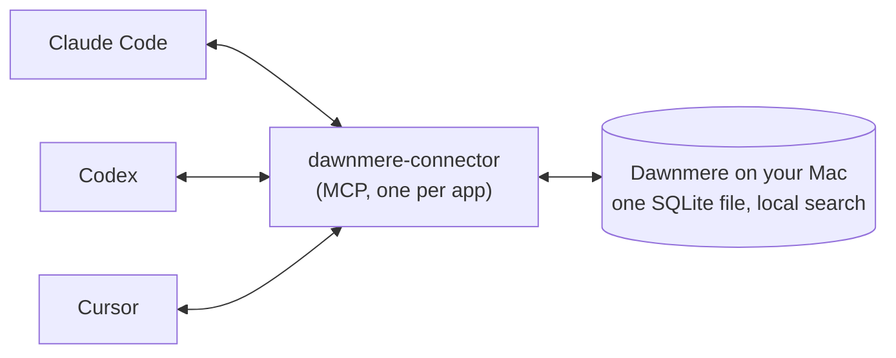

<!-- Japanese translation of README.md (6fa4b8b). Change it together with README.md and README.zh-CN.md; the comments
     are copied from README.md unchanged. -->

<p align="center"><a href="README.md">English</a> | <a href="README.zh-CN.md">简体中文</a> | <b>日本語</b></p>

<h1 align="center">
  <picture>
    <source media="(prefers-color-scheme: dark)" srcset="assets/lockup-dark.svg">
    
  </picture>
</h1>

<p align="center"><b>ひとつの AI に伝えれば、どの AI も知っている。</b><br>
Mac の中のひとつのメモリを、Claude Code・Codex・Cursor で共有します。</p>

<p align="center">
  
</p>

```bash
curl -fsSL https://dawnmere.app/install | sh
```

**必要なもの：** Apple シリコン搭載の Mac、macOS 14 以降、1 GB の空きディスク容量、Node.js 18 以降。無料で、アカウントは不要です。<br>
**ご注意：** 日本語のメモは、同じ言葉を使って質問すると見つかります。言い換えた質問はまだ見つからないことが多いです（[#27](https://github.com/Hadeva-Dev/dawnmere/issues/27)）。<br>
**ステータス：** 初期ベータ（0.1.x）。クライアントは MIT、エンジンはソース公開（source-available、FSL。2 年後に MIT へ移行）。開発は [LF Labs](#who-makes-it-and-the-lf-labs-names) です。

<!-- Apple silicon and macOS 14: install.sh:35-38 refuses anything else, and setup.py:73-74 checks macOS again.
     Node 18: connector/package.json "engines" >=18; every app's MCP entry runs `npx -y dawnmere-connector@...`
     (layout.py:11-12, apps.py:43-44, plugin/.mcp.json). 1 GB: setup.py:28,79-81. dawnmere.app/install answers 200
     with install.sh from the latest release (checked 2026-11-09). -->

## できること

覚えておく価値のあることを、Claude Code か Codex に伝えます（たとえば "remember that we deploy on Fridays"）。Dawnmere はそれをあなたの Mac に一度だけ保存します。もう一方のアプリで似た言葉でたずねると、そのメモリが出てきます。そのプロジェクトで新しく開いた Cursor のチャットにも、その後 1 日のあいだ表示されます。Claude Code で上限に達して Codex に乗り換えても、Codex は「デプロイは金曜」「pnpm を使う」ことを思い出せます。



各アプリでの呼び出し（recall）と保存のしかた：

| アプリ | 呼び出し | 保存 |
| --- | --- | --- |
| **Claude Code** | 毎回のプロンプトに挿入。セッション開始時にも | セッションの操作がしばらく止まったあとに自動で（モデルを選んだ場合）、"remember that ..." と入力したとき、またはモデルが `remember` を呼んだとき |
| **Codex** | 毎回のプロンプトに挿入 | "remember that ..." と入力したとき、またはモデルが `remember` を呼んだとき |
| **Cursor** | 各チャットの開始時 | モデルが `remember` を呼んだとき |

あなたが入力したこと（"remember that ..."）は、返答が終わるとすべてのアプリに届きます（Codex で入力した場合は、そこで次のプロンプトを送ったときです）。モデルが自分の判断で `remember` を使って保存したメモは検索で見つかりますが、ほかのアプリのプロンプトに入るのは、あなたが確認したあと（`lflabs-memory held`）だけです。あなた自身の健康、家族、お金、法律に関わるメモは、個人的なメモのままになります。
<!-- checked against v0.1.6 (406ee39/c3ed5b1): a `remember` with no kind from a work-only app (Cursor by default) is
     filed as work, unless it is about the user's health, family, money or legal matters. -->

<!-- Claude Code hooks: plugin/hooks/hooks.json (UserPromptSubmit, SessionStart, Stop, SessionEnd). Codex: a
     UserPromptSubmit hook running hook-prompt (apps.py:146-153). Cursor: a sessionStart hook only (apps.py:156-163).
     Typed "remember that ..." saved by the prompt hook: engine instant.py:3. Automatic saving needs a model:
     backend.py:17. -->

どのアプリにも、MCP 経由で 4 つのツールが加わります：`recall`、`remember`、`forget`、`access_status`。
<!-- connector/src/server.ts:24-87 -->

## Dawnmere を選ぶ理由

- **アプリごとではなく、メモリはひとつ。** すべてのアプリがひとつのストアを共有するので、Claude Code で保存した事実が、そのまま Cursor が呼び出す事実になります。
- **保存先はあなたの Mac だけです。** メモリは Library フォルダにあるひとつの SQLite ファイルです。検索は小さなローカルモデルを使って Mac 上で行います。アカウントはなく、LF Labs には何も送られず、ツールが利用データを集めることもありません。
- **読み取りには、あなた自身のモデルを使います。** 自動保存には、Claude Code 経由のあなたの Claude プランか、あなた自身の Anthropic API キーを使います。モデルなしで動かすこともできます。
- **各アプリが見られるのは、あなたが許可した範囲だけ。** Cursor は最初は仕事用のメモしか見られません。新しく接続したアプリも同じです。Claude Code と Claude Desktop のメモリツール、そして名前を名乗るだけのアプリも、今のところ仕事用のメモしか見られません。Claude Code がプロンプトに自動で挿入する呼び出しは、引き続きすべてを見られます。アプリが見られる範囲を広げるには、あなた自身がターミナルで操作する必要があります。`dawnmere access cursor everything` を実行し、アプリの名前をもう一度入力して、macOS のダイアログで「Allow」をクリックします。チャットで頼んでも、このコマンドが返ってくるだけです。
  <!-- checked against v0.1.6 (406ee39/c3ed5b1): MCP tools of Claude Code, Claude Desktop and self-named apps see
       work only; the prompt hook sees everything; Terminal widening asks for the app's name and an Allow dialog
       (access.py engine_widens). A widening typed in Claude Code or Codex is never applied;
       the reply gives the Terminal command (engine 50ffd0b, typed widening refused). -->
- **保存されるテキストはチェックされます。** API キーやトークンのように見えるテキストは拒否されます。ダウンロードしたコードを実行させる、ファイルを削除させる、あなたに何かを隠させる、アシスタント自身の指示を書き換えようとする、といったアプリからの保存も拒否されます。アプリが自分の判断で保存したメモは、検索専用として保存されてラベルが付き、あなたが確認したあと（`lflabs-memory held`）にだけ、ほかのアプリのプロンプトに入ります。呼び出されたメモは "notes, not instructions"（指示ではなくメモ）というラベル付きでアプリに渡ります。
  <!-- checked against v0.1.6 (406ee39/c3ed5b1): MCP `remember` goes through the instruction screen; only some app
       saves are refused, the rest that read as rules, instructions, commands or links are kept search-only until
       "confirm memory N". Key/token refusals: mem.py:1373-1378. Label: mem.py:3919, instant.py:34. -->
- **セットアップは元に戻せます。** 何かを変える前に必ず確認し、触れるファイルはすべてバックアップします。`--dry-run` で計画だけを表示でき、`dawnmere uninstall` でファイルを元に戻せます。

<!-- Local store and models: engine METADATA "SQLite + vectors + keyword search", models.json (bge-small, MiniLM
     reranker, optional sense model). No usage data: no telemetry code in the CLI; the engine turns off onnxruntime's
     telemetry (mem.py:206-208). Access defaults: settings.py:9 new_clients "work"; setup.py:100,135-137 Cursor
     personal notes off unless you say yes. Backups and record: setup.py:6, edits.py, uninstall.py:44-72. -->

## ほかのツールとの比較

コーディングエージェントの間でひとつのメモリを共有すること自体は、新しい発想ではありません。claude-mem と Supermemory も同じことができ、どちらも Dawnmere より多くのエージェントに対応しています。大きな違いは、メモリをどこに置くかです。2026 年 11 月 8 日時点の各プロジェクトのドキュメントによると、次のとおりです。

| | メモリの保存場所 | Claude Code・Codex・Cursor での共有 |
| --- | --- | --- |
| **Dawnmere** | あなたの Mac 上のひとつの SQLite ファイル。検索も Mac 上で実行 | あり（デフォルト）。各アプリは許可された範囲だけを見る |
| [claude-mem](https://github.com/thedotmack/claude-mem) | あなたのマシンの `~/.claude-mem` | 3 つすべてに加え、ほかにも対応。セッション開始時にほかのエージェントのメモリを読み込むのはオプトイン |
| [Supermemory](https://supermemory.ai/coding-agents/) | デフォルトはホスト型。`npx supermemory local` で手元のマシンでも動く（両者の間でメモリは共有されない） | あり。OpenCode などにも対応 |
| [Mem0 MCP](https://docs.mem0.ai/platform/mem0-mcp) | Mem0 がホストし、Mem0 アカウントが必要。あなたのマシンでは何も動かない | あり（そのアカウント経由） |
| 組み込みのメモリ | プロジェクトとホームフォルダの [CLAUDE.md と自動メモリ](https://code.claude.com/docs/en/memory)、リポジトリの [AGENTS.md](https://agents.md/) | CLAUDE.md と自動メモリは Claude Code 専用。AGENTS.md は Codex と Cursor が読み、リポジトリに CLAUDE.md がなければ Claude Code も読むが、中身はあなたが書いた指示であって、アプリが学んだことではない |

使うエージェントがひとつだけなら、組み込みのメモリで十分かもしれません。Dawnmere もそこから始めます。セットアップのときに、Claude Code がすでに保存しているメモを取り込めます。

<!-- Sources, read 2026-11-08: claude-mem README ("Your memory lives in ~/.claude-mem on your machine"; "Works with
     Claude Code, Codex, Cursor, OpenCode and 11 more agents"; CLAUDE_MEM_SESSION_START_INCLUDE_ALL_SOURCES defaults
     to "false"). Supermemory coding-agents page ("a decision saved in Claude Code is there when you open Cursor";
     "Memories don't move between Local and the hosted service"; lists Claude Code, Cursor, Codex, OpenCode, Hermes).
     Mem0 MCP docs ("Nothing runs on your machine: the server is hosted by Mem0"; prerequisites: Mem0 Platform account
     and API key; clients include Claude Code, Codex, Cursor). agents.md lists Codex and Cursor; Claude Code's memory
     docs say it reads AGENTS.md when there is no CLAUDE.md. Import of Claude Code notes: setup.py:103-143. -->

## インストール

```bash
curl -fsSL https://dawnmere.app/install | sh
```

このアドレスは、最新の [GitHub release](https://github.com/Hadeva-Dev/dawnmere/releases/latest) にある `install.sh` をそのまま返します。スクリプトは次のことを行います。

1. Apple シリコン搭載で macOS 14 以降の Mac でなければ、そこで止まります。
2. 新しめの [uv](https://github.com/astral-sh/uv) がなければ uv 0.12.5 をダウンロードし、release から `dawnmere` とエンジンのパッケージをダウンロードします。
3. それらのファイルを、スクリプトに書き込まれた sha256 値と照合します。ひとつでも違えば何もインストールしません。
4. uv に Python 3.12 でインストールさせます。エンジンが使う Python パッケージは PyPI から取得し、どれも正確なバージョンに固定したうえで sha256 を照合します。
   <!-- checked against v0.1.6 (406ee39/c3ed5b1): dependencies pinned with hashes. Before that, install.sh:110-115
        let uv resolve them unpinned. -->
5. 新しいターミナルウィンドウが `dawnmere` を見つけられるよう、`~/.zprofile` に目印付きの行を 1 行追加し、そのことを知らせます（すでに見つけられる場合は追加しません）。
   <!-- checked against v0.1.6 (406ee39/c3ed5b1): install.sh appends a marked PATH line to ~/.zprofile (e6b3df0). -->
6. `dawnmere setup` を起動します。setup は何かを変える前に必ず確認します。

確認を取れるターミナルがない場合（スクリプトから実行する場合など）、インストーラーはプログラムをインストールしますが、セットアップは実行しません。そのため、アプリは何も変更されません。あとでターミナルウィンドウで `dawnmere setup` を実行するか、`dawnmere setup --yes` でデフォルトのまま進めてください。
<!-- checked against v0.1.6 (406ee39/c3ed5b1): install.sh reads no arguments; with no TTY it installs, edits
     ~/.zprofile, skips setup and says to run `dawnmere setup --yes`. -->

<!-- install.sh:20-22 (uv pin and hash), 33-38 (platform checks), 81-96 (fetch and check), 110-115 (uv tool install
     with --managed-python --python 3.12 and --with the engine wheel). -->

### 先にインストーラーを読む

```bash
curl -fsSL https://dawnmere.app/install -o install.sh
less install.sh
sh install.sh
```

このリポジトリの `install.sh` はテンプレートです。release がバージョンとチェックサムを書き込むまでは、実行を拒否します。
<!-- install.sh:10-18, 32 -->

アプリは PATH に依存しません。セットアップが書き込むフックは、Dawnmere をフルパスで呼び出します。インストーラーが `~/.zprofile` に追加した行は、`dawnmere uninstall` で取り除かれます。
<!-- checked against v0.1.6 (406ee39/c3ed5b1): plugin hooks get absolute paths; uninstall removes the marked
     ~/.zprofile line. -->

**アップデート：** `dawnmere update` を実行します。release の `SHA256SUMS` で各ファイルを照合します。インストール用のコマンドをもう一度実行しても構いません。
<!-- update.py:55-70 -->

## セットアップで行うこと

`dawnmere setup` は、まず何をするかを表示し、続けてよいか確認します。次に、AI アプリにあなたを何と呼ばせるか、バックグラウンドでの読み取りに Claude プランを使うか（Anthropic API キーも使えます。キーはキーチェーンに保存されます）、Cursor に個人的なメモを見せるか（同意しない限り見せません）、Claude Code がすでに `~/.claude/projects/*/memory` に保存しているメモを取り込むかを尋ねます（取り込んだメモを自分のものとして信頼するか、macOS のダイアログで一度だけ確認します。信頼しない場合は、確認するまで検索専用になります）。

そのあと、各ステップを実行しながら表示します。

| ステップ | 内容 |
| --- | --- |
| Claude Code | `claude` があり、ログイン済みかを確認 |
| 検索モデル | 検索モデル（約 310 MB）をダウンロードし、各ファイルのサイズと sha256 を確認 |
| メモリサービス | 検索を速く保つバックグラウンドサービス（LaunchAgent）を起動 |
| アプリ | インストールされていれば Claude Code、Codex、Cursor を接続 |
| メモ | Claude Code のメモを取り込む |
| セルフチェック | テスト用のメモリを保存し、Codex や Cursor と同じ方法で見つけてから削除 |

最後に "Dawnmere is on." と表示されます。セットアップが変更するファイルはすべて、変更前にすぐ隣へコピーされ（`<file>.lflabs-backup-<time>`）、`dawnmere uninstall` で元に戻せるよう記録されます。セットアップはいつでも再実行できます。たとえば、あとからモデルを追加したいときです。

- `dawnmere setup --dry-run` は、行う予定の変更をすべて表示するだけで、何も変更しません。
- `dawnmere setup --backend none` はモデルなしで動かします。呼び出しと remember は使えますが、自動保存はオフになります。

<!-- Questions: setup.py:103-143. Models: models.json totals 310.2 MB (embed 34.7, rerank 23.9, sense 251.6; sense
     is skipped below 2 GB free, setup.py:29,226). Checks: models.py:60. Self-check: setup.py:407-408.
     "Dawnmere is on.": screen.py:524,581. Backups: layout.py:17. -->

## 対応アプリ

- **Claude Code**（2.1.301 以降）：インストールした release と同じバージョンの `lflabs-memory` プラグインを、このリポジトリからインストールします。プラグインがツールと 4 つのフックを追加します。プラグインをインストールできない場合は、`claude mcp add` で同じツールを追加し、フックを `~/.claude/settings.json` に書き込みます。
  <!-- checked against v0.1.6 (406ee39/c3ed5b1): the plugin pins to the release tag. -->
- **Codex**：`~/.codex/config.toml` に `[mcp_servers.lflabs-memory]` を、`~/.codex/hooks.json` にプロンプトフックを追加します。Codex で一度 `/hooks` と入力し、フックを信頼してください。
- **Cursor**：`~/.cursor/mcp.json` に `lflabs-memory` を、`~/.cursor/hooks.json` にセッション開始フックを追加します。そのあと Cursor を再起動してください。`dawnmere access cursor everything` を実行するまで、Cursor は仕事用のメモしか見られません。`dawnmere access cursor work` で元に戻せます。
- **Windsurf、Gemini CLI、VS Code（Copilot）**：セットアップがこれらを見つけると、それぞれの MCP 設定ファイル（`~/.codeium/windsurf/mcp_config.json`、`~/.gemini/settings.json`、`~/Library/Application Support/Code/User/mcp.json`）に `lflabs-memory` を追加します。そのあとアプリを再起動してください。追加されるのはツールだけでフックはないため、ツールを呼び出したときにだけ思い出し、見られるのは仕事用のメモだけです。
- **Claude Desktop とそのほかの MCP アプリ**：セットアップでは接続しません。Claude Desktop の場合は、[最新の release](https://github.com/Hadeva-Dev/dawnmere/releases/latest) から `dawnmere-connector.mcpb` を開くか、次の内容を `~/Library/Application Support/Claude/claude_desktop_config.json` に追加してください。

  ```json
  {
    "mcpServers": {
      "lflabs-memory": {
        "command": "npx",
        "args": ["-y", "dawnmere-connector@0.1.1"]
      }
    }
  }
  ```

  <!-- checked against v0.1.6 (406ee39/c3ed5b1): connector 0.1.1 matches layout.py CONNECTOR_VERSION. -->
  Windsurf や Gemini CLI などの設定は、[コネクタの README](connector/README.md) にあります。

<!-- MIN_CLAUDE layout.py:20. Plugin then fallback: setup.py:294-313. Codex: apps.py:100-116, 146-153; hint
     apps.py:27. Cursor: apps.py:156-163, access.py:18-21, 124-126. The .mcpb is a release asset. -->

## コマンド

| コマンド | 内容 |
| --- | --- |
| `dawnmere setup` | この Mac にあるひとつのメモリに、アプリを接続する |
| `dawnmere doctor` | Node.js も含めて、すべてが動くか確認する。1 項目 1 行で、問題ごとに対処法も表示 |
| `dawnmere export` | メモリを `~/Downloads/dawnmere-export-<date>.json` に保存する（Markdown なら `--format md`） |
| `dawnmere import FILE` | エクスポートファイルからメモリを追加する。すでにあるものはスキップ。macOS のダイアログで一度確認するまでは、アプリが保存したものとして扱われる |
| `dawnmere access APP [LEVEL]` | アプリが見られる範囲を表示・変更する：`everything`、`nothing-personal`、`work`、`nothing`（ここから広げられるのは Cursor と Codex だけ） |
| `dawnmere update` | 最新の release をインストールし、チェックサムで照合する |
| `dawnmere uninstall` | セットアップが追加したものをすべて削除する |

<!-- checked against v0.1.6 (406ee39/c3ed5b1): doctor checks Node. Commands: main.py:76-131. Export path:
     export.py:79. Import skips duplicates: export.py:112-134. Levels and widening: access.py:18, 124-126. -->

`dawnmere doctor --report` は件数だけを出力します（メモリの本文、名前、パスは含みません）。そのまま issue に貼っても安全です。
<!-- doctor.py:274-297 -->

## 忘れさせる（forget）

自分でメモリを忘れさせた場合（Claude Code や Codex で "forget memory 12" と入力するか、ターミナルで `lflabs-memory forget 12` を実行）、その本文、検索用のエントリ、古いバージョン、そこから取り出された事実が、返答が終わるとメモリファイルとそのバックアップから削除されます（Codex で入力した場合は、そこで次のプロンプトを送ったときです）。元には戻せません。バックグラウンドでの読み取りがオンの場合は、その言葉に触れているほかのメモをバックグラウンドの処理が見つけられるよう、言葉だけが最大 24 時間残り、そのあと消去されます。アプリが自分で `forget` を呼んだ場合、そのメモリはすぐに非表示になり、24 時間後に完全に削除されます。それまでは `lflabs-memory restore 12` で元に戻せます。言葉を含まないフィンガープリントだけは残るので、古いチャットから同じことがもう一度保存されることはありません。`dawnmere uninstall` でメモリ全体を削除することもできます（先に確認します）。

Claude Code も独自のメモリファイル（`~/.claude/projects/` 以下）を保存しています。Dawnmere でメモを忘れさせても、それらは削除されません。そちらのメモも削除するか、Claude Code に忘れるよう頼んでください。
<!-- checked against v0.1.6 (406ee39/c3ed5b1): your own forget is a real delete (words kept up to 24 h when a model
     is on); an app's forget hides the memory, deletes it after 24 h, and `restore` brings it back until then. Before
     v0.1.6 every forget was a soft delete with `lflabs-memory purge` and `restore` (mem.py:1787-1790, 1954-1973). -->

## Mac の外に出るもの

あなたのメモリが私たちのもとへアップロードされることはなく、LF Labs には何も送られません。Mac の外に出るものは次のとおりです。

- **バックグラウンドでの読み取り**（モデルを選んだ場合）：あなたの Claude Code の会話を、あなた自身のプロバイダー（Claude Code 経由のあなたの Claude プラン、またはあなたのキーでの Anthropic API）に送ります。送るのは、あなたのメッセージ 6 件ごとと、セッションの操作がしばらく止まったときで、関連するメモリを最大 8 件添えます。その中には Codex や Cursor から保存されたものが含まれることもあります。ほかに、整理待ちのメモリ、Claude Code や Codex で入力した英語以外のプロンプト（英語で検索するため）、忘れさせたものの言葉（最大 24 時間）も送ります。週に一度（セットアップの少しあとにも一度）、ほぼ同じ内容のメモリ、古くなったと読めるメモリ、日付つきの状況メモを、それぞれ関連するメモリ数件と一緒に送り、統合・書き直し・無効化を行います。これらすべてを合わせて 1 日あたり最大 200 回です。モデルがなければ、これらは何も送られません。
- **GitHub**：release とアップデート。GitHub の `gh` がインストール済みでログインしていれば、作業中のリポジトリのオープンな pull request も取得します。
- **ダウンロード**：uv、Python、エンジンが使う Python パッケージ（GitHub と PyPI から）、検索モデルと Claude Code プラグイン（このリポジトリとその release から）、コネクタ（npm から一度ダウンロードし、アプリが起動するたびに npm に問い合わせます）。`dawnmere update` は GitHub に最新の release を問い合わせます。
- **セットアップでのモデルの確認**：Claude Code か Anthropic API に、短いテスト呼び出しを 1 回送ります。
- **インストールのコマンド**：dawnmere.app は、インストールスクリプトが取得されるたびに数えます（取得したツール、参照元のサイト、国。IP アドレスは保存しません）。そのあと GitHub に転送します。サイト自体の計測については[プライバシーのページ](https://dawnmere.app/privacy)をご覧ください。

各アプリが自分のモデルに何を送るかは、それぞれのアプリが決めます。メモリから呼び出した内容も同じです。

<!-- checked against v0.1.6 (406ee39/c3ed5b1): what goes to the model provider and to GitHub, as listed.
     200 a day: settings.py:8. Ping: backend.py:59-104. Models URL: THIRD_PARTY.md and models.json. -->

## アンインストール

```bash
dawnmere uninstall
```

バックグラウンドサービスを止めて削除し、Claude Code、Codex、Cursor からメモリを外します（各ファイルを元どおりに戻します。そのあとファイルを変更していた場合は、Dawnmere の項目だけを削除します）。さらにキーチェーンから API キーを削除し、`dawnmere` とエンジンのプログラムを削除します。メモリを削除する前には必ず確認します。削除したメモリは元に戻せません。残したいときは「いいえ」と答えるか、`--keep-data` を付けてください。セットアップが作ったバックアップは削除します。元どおりに戻せなかったファイルがあれば、セットアップ前のコピーがその隣に残り、アンインストール時に一覧で表示されます。インストーラーが `~/.zprofile` に追加した行も取り除きます。uv とそれがダウンロードした Python は Mac に残ります。削除のしかたはアンインストール時に表示されます。

<!-- checked against v0.1.6 (406ee39/c3ed5b1): uninstall deletes the .lflabs-backup-* files except a pre-setup copy
     of a file it could not restore, removes the ~/.zprofile line, leaves uv and its Python. uninstall.py:44-140 -->

<a id="who-makes-it-and-the-lf-labs-names"></a>
## 開発元と「LF Labs」という名前

Dawnmere は LF Labs（GitHub の [Hadeva-Dev](https://github.com/Hadeva-Dev) organization）が開発しています。プログラムの内部では LF Labs の名前を使っているため、次のものはすべて Dawnmere のものです。

| 項目 | 場所 |
| --- | --- |
| メモリ、設定、モデル | `~/Library/Application Support/LF Labs/Memory/`（読めるのはあなただけ） |
| サービスのログ | `~/Library/Logs/LF Labs/memory.log` |
| バックグラウンドサービス | `~/Library/LaunchAgents/com.lflabs.memory.plist` |
| MCP サーバー ID と Claude Code プラグイン | `lflabs-memory`（プラグインは `lflabs-memory@lflabs`） |
| プログラム | `~/.local/share/uv/tools/lflabs-memory-cli/`（`~/.local/bin/dawnmere` と `lflabs-memory` にリンク） |
| Anthropic API キー（設定した場合） | ログインキーチェーンの "LF Labs Memory" |

<!-- layout.py:9-16, 33-56; setup.py:462-463 (0700 data folder). -->

## 制限事項

- **Mac 専用**です。Apple シリコン、macOS 14 以降が必要です。エンジンの ONNX ランタイムには Intel Mac 版がなく、Linux 版や Windows 版もありません。
- **Mac 1 台だけ。** マシン間の同期や、チームで共有するメモリはありません。
- **中国語と日本語の想起は言葉の一致で行います。** 中国語や日本語で保存したメモは、同じ言葉を一部使って質問したときにプロンプトへ追加されます。言い換えた質問は見つからないことがよくありますが、アプリから検索はできます。モデルを設定している場合、中国語や日本語の質問は英語でも検索されます（1回につき小さなモデル呼び出し1回）。入力して保存するには "remember that ..." と書きます。日本語なら "覚えておいて：..." でも保存できます。
- **保存がいちばん確実なのは Claude Code です。** Codex では "remember that ..." と言ってください。Cursor ではモデルが `remember` を呼ぶ必要があります。Codex 自身のセッションファイルは、`dawnmere setup --codex-sessions` を実行した場合だけ読み取ります。
- **チェックは自動なので、見逃すこともあります。** アプリが何を保存したかは `dawnmere export` で確認してください。
- **初期ベータです。** リリースは手作業で、頻繁に出ます。アップデートの前に [リリースノート](https://github.com/Hadeva-Dev/dawnmere/releases) を読んでください。

<!-- Intel: install.sh:37 comment. Releases by hand: RELEASING.md line 3. -->

## ライセンス

このリポジトリにあるインストーラー、`dawnmere` コマンド、Claude Code プラグイン、コネクタは MIT ライセンスです（[LICENSE](LICENSE)）。[エンジン](https://github.com/Hadeva-Dev/lflabs-memory-engine) は [Functional Source License 1.1, MIT future license](https://github.com/Hadeva-Dev/lflabs-memory-engine/blob/main/LICENSE)（FSL-1.1-MIT）のもとでソースコードを公開しており、各バージョンはリリースから 2 年後に MIT になります。検索モデルにはそれぞれのライセンスが適用されます（`dawnmere doctor --licenses` と [THIRD_PARTY.md](THIRD_PARTY.md) を参照）。

## 関連プロジェクト

[memory-bench](https://github.com/Hadeva-Dev/memory-bench) は、アシスタントのメモリを評価するオープンなベンチマークで、同じチームが作っています。公開されているエンジンで測った Dawnmere の行があり、漏れの数と呼び出しの結果が並べて示されています。そこにあるメンテナーのもう一つの行は関連するシステムのもので、ベンチマークにもそう明記されています。

バグを見つけたら、`dawnmere doctor --report` の出力を添えて [issue を作成](https://github.com/Hadeva-Dev/dawnmere/issues/new/choose)してください。セキュリティの問題は [SECURITY.md](SECURITY.md) の手順で報告してください。
