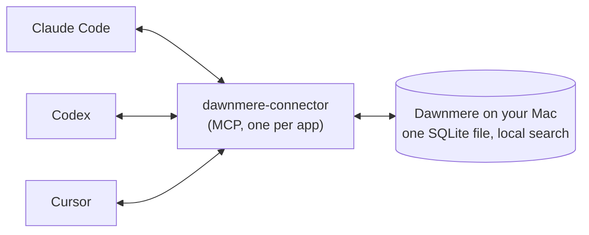

<p align="center"><b>English</b> | <a href="README.zh-CN.md">简体中文</a> | <a href="README.ja.md">日本語</a></p>

<h1 align="center">
  <picture>
    <source media="(prefers-color-scheme: dark)" srcset="assets/lockup-dark.svg">
    
  </picture>
</h1>

<p align="center"><b>Tell one AI. They all know.</b><br>
One memory on your Mac, shared by Claude Code, Codex and Cursor.</p>

<p align="center">
  
</p>

```bash
curl -fsSL https://dawnmere.app/install | sh
```

**Needs:** a Mac with Apple silicon, macOS 14 or later, 1 GB of free disk space, and Node.js 18 or later. Free, no
account.<br>
**Status:** early beta (0.1.x). MIT client, source-available engine (FSL, becomes MIT after two years).
Made by [LF Labs](#who-makes-it-and-the-lf-labs-names).

<!-- Apple silicon and macOS 14: install.sh:35-38 refuses anything else, and setup.py:73-74 checks macOS again.
     Node 18: connector/package.json "engines" >=18; every app's MCP entry runs `npx -y dawnmere-connector@...`
     (layout.py:11-12, apps.py:43-44, plugin/.mcp.json). 1 GB: setup.py:28,79-81. dawnmere.app/install answers 200
     with install.sh from the latest release (checked 2026-11-09). -->

## What it does

You tell Claude Code or Codex something worth keeping ("remember that we deploy on Fridays"). Dawnmere saves it
once, on your Mac. Ask the other one in similar words and it brings it up, and a new Cursor chat in that project
shows it for the next day. Switch from Claude Code to Codex when you hit a limit, and Codex can recall that you
deploy on Fridays and use pnpm.



How each app saves and recalls:

| App | Recalls | Saves |
| --- | --- | --- |
| **Claude Code** | into each prompt, and at the start of a session | on its own after a session goes quiet (if you chose a model), when you type "remember that ...", or when the model calls `remember` |
| **Codex** | into each prompt | when you type "remember that ...", or when the model calls `remember` |
| **Cursor** | at the start of each chat | when the model calls `remember` |

What you type ("remember that ...") reaches every app once the reply finishes (from Codex, at your next prompt there).
A note a model saves with `remember` on its own is found by searching, and reaches other apps' prompts only after you confirm it (`lflabs-memory held`).
Notes about your own health, family, money or legal matters stay personal.
<!-- checked against v0.1.6 (406ee39/c3ed5b1): a `remember` with no kind from a work-only app (Cursor by default) is
     filed as work, unless it is about the user's health, family, money or legal matters. -->

<!-- Claude Code hooks: plugin/hooks/hooks.json (UserPromptSubmit, SessionStart, Stop, SessionEnd). Codex: a
     UserPromptSubmit hook running hook-prompt (apps.py:146-153). Cursor: a sessionStart hook only (apps.py:156-163).
     Typed "remember that ..." saved by the prompt hook: engine instant.py:3. Automatic saving needs a model:
     backend.py:17. -->

Every app also gets four tools through MCP: `recall`, `remember`, `forget` and `access_status`.
<!-- connector/src/server.ts:24-87 -->

## Why Dawnmere

- **One memory, not one per app.** The apps share a single store, so a fact saved from Claude Code is the same
  fact Cursor recalls.
- **Stored only on your Mac.** The memory is one SQLite file in your Library folder. Search runs on your Mac with
  small local models. There is no account, nothing is sent to LF Labs, and the tool collects no usage data.
- **Your own model does the reading.** Automatic saving uses your Claude plan through Claude Code, or your own
  Anthropic API key. You can also run with no model at all.
- **Each app sees what you allow.** Cursor starts with work notes only, and a new app sees work notes only.
  Claude Code's and Claude Desktop's memory tools, and any app that only names itself, see work notes only for now.
  Claude Code's automatic recall in your prompts still sees everything. Widening an app's access needs you at a
  Terminal: run `dawnmere access cursor everything`, type the app's name back and click Allow in a macOS dialog.
  Asking for it in a chat only gets you that command.
  <!-- checked against v0.1.6 (406ee39/c3ed5b1): MCP tools of Claude Code, Claude Desktop and self-named apps see
       work only; the prompt hook sees everything; Terminal widening asks for the app's name and an Allow dialog
       (access.py engine_widens). A widening typed in Claude Code or Codex is never applied;
       the reply gives the Terminal command (engine 50ffd0b, typed widening refused). -->
- **Saved text is screened.** Text that looks like an API key or token is refused. An app's save that would run
  downloaded code, delete files, keep something from you or tries to override your assistant's instructions is refused. Notes
  an app saves on its own are kept for search, labelled, and reach other apps' prompts only after you confirm them
  (`lflabs-memory held`). Recalled notes reach the app labelled "notes, not
  instructions".
  <!-- checked against v0.1.6 (406ee39/c3ed5b1): MCP `remember` goes through the instruction screen; only some app
       saves are refused, the rest that read as rules, instructions, commands or links are kept search-only until
       "confirm memory N". Key/token refusals: mem.py:1373-1378. Label: mem.py:3919, instant.py:34. -->
- **Setup can be undone.** It asks before changing anything, backs up every file it touches, can show its plan with
  `--dry-run`, and `dawnmere uninstall` puts the files back.

<!-- Local store and models: engine METADATA "SQLite + vectors + keyword search", models.json (bge-small, MiniLM
     reranker, optional sense model). No usage data: no telemetry code in the CLI; the engine turns off onnxruntime's
     telemetry (mem.py:206-208). Access defaults: settings.py:9 new_clients "work"; setup.py:100,135-137 Cursor
     personal notes off unless you say yes. Backups and record: setup.py:6, edits.py, uninstall.py:44-72. -->

## How it compares

Sharing one memory between coding agents is not new: claude-mem and Supermemory do it too, and both cover more
agents than Dawnmere. The main difference is where the memory is kept. As each project's own docs describe it on
8 November 2026:

| | Where the memory is kept | Shared by Claude Code, Codex and Cursor |
| --- | --- | --- |
| **Dawnmere** | one SQLite file on your Mac; search runs on your Mac | yes, by default; each app sees what you allow |
| [claude-mem](https://github.com/thedotmack/claude-mem) | `~/.claude-mem` on your machine | supports all three and more; other agents' memories at session start are opt-in |
| [Supermemory](https://supermemory.ai/coding-agents/) | hosted by default, or on your machine with `npx supermemory local` (the two do not share memories) | yes, plus OpenCode and others |
| [Mem0 MCP](https://docs.mem0.ai/platform/mem0-mcp) | hosted by Mem0, with a Mem0 account; nothing runs on your machine | yes, through that account |
| Built-in memory | [CLAUDE.md and auto memory](https://code.claude.com/docs/en/memory) in your projects and home folder; [AGENTS.md](https://agents.md/) in your repos | CLAUDE.md and auto memory are Claude Code's own; AGENTS.md is read by Codex, Cursor and (when a repo has no CLAUDE.md) Claude Code, but holds instructions you write, not what the apps learn |

If you use only one agent, its built-in memory may be all you need. Dawnmere starts from it: setup can import the
notes Claude Code already keeps.

**Why not CLAUDE.md or AGENTS.md?** Use them for rules you write on purpose; Dawnmere doesn't replace them. Dawnmere
is for the things you say in passing and don't want to copy into three files. Recall is selective, so an app gets
the memories that match the prompt, not the whole file every time.

<!-- Sources, read 2026-11-08: claude-mem README ("Your memory lives in ~/.claude-mem on your machine"; "Works with
     Claude Code, Codex, Cursor, OpenCode and 11 more agents"; CLAUDE_MEM_SESSION_START_INCLUDE_ALL_SOURCES defaults
     to "false"). Supermemory coding-agents page ("a decision saved in Claude Code is there when you open Cursor";
     "Memories don't move between Local and the hosted service"; lists Claude Code, Cursor, Codex, OpenCode, Hermes).
     Mem0 MCP docs ("Nothing runs on your machine: the server is hosted by Mem0"; prerequisites: Mem0 Platform account
     and API key; clients include Claude Code, Codex, Cursor). agents.md lists Codex and Cursor; Claude Code's memory
     docs say it reads AGENTS.md when there is no CLAUDE.md. Import of Claude Code notes: setup.py:103-143. -->

## Install

```bash
curl -fsSL https://dawnmere.app/install | sh
```

Prefer Homebrew?

```bash
brew install hadeva-dev/tap/dawnmere
dawnmere setup
```

Homebrew brings Node.js with it. Update with `brew upgrade hadeva-dev/tap/dawnmere`, then run `dawnmere setup`
again. To remove it, run `dawnmere uninstall` before `brew uninstall dawnmere`.

That address serves `install.sh` from the latest
[GitHub release](https://github.com/Hadeva-Dev/dawnmere/releases/latest). The script:

1. stops unless this is a Mac with Apple silicon and macOS 14 or later;
2. downloads [uv](https://github.com/astral-sh/uv) 0.12.5 if you do not have a recent one, and the `dawnmere` and
   engine packages from the release;
3. checks those files against sha256 values written into the script, and installs nothing if one differs;
4. has uv install them with Python 3.12 and the engine's Python packages from PyPI, each pinned to an exact version
   and checked against its sha256;
   <!-- checked against v0.1.6 (406ee39/c3ed5b1): dependencies pinned with hashes. Before that, install.sh:110-115
        let uv resolve them unpinned. -->
5. adds one marked line to `~/.zprofile` so new Terminal windows find `dawnmere`, unless they already do, and says so;
   <!-- checked against v0.1.6 (406ee39/c3ed5b1): install.sh appends a marked PATH line to ~/.zprofile (e6b3df0). -->
6. starts `dawnmere setup`, which asks before it changes anything.

Without a terminal to ask in (in a script, say), the installer installs the programs but does not run setup, so none
of your apps is changed. Afterwards run `dawnmere setup` in a Terminal window, or `dawnmere setup --yes` to take the
defaults.
<!-- checked against v0.1.6 (406ee39/c3ed5b1): install.sh reads no arguments; with no TTY it installs, edits
     ~/.zprofile, skips setup and says to run `dawnmere setup --yes`. -->

<!-- install.sh:20-22 (uv pin and hash), 33-38 (platform checks), 81-96 (fetch and check), 110-115 (uv tool install
     with --managed-python --python 3.12 and --with the engine wheel). -->

### Read the installer first

```bash
curl -fsSL https://dawnmere.app/install -o install.sh
less install.sh
sh install.sh
```

The `install.sh` in this repo is the template: it refuses to run until a release fills in the version and checksums.
<!-- install.sh:10-18, 32 -->

Your apps do not depend on your PATH: the hooks setup writes call Dawnmere by its full path. `dawnmere uninstall`
takes the installer's `~/.zprofile` line out again.
<!-- checked against v0.1.6 (406ee39/c3ed5b1): plugin hooks get absolute paths; uninstall removes the marked
     ~/.zprofile line. -->

**Updating:** `dawnmere update`, which checks each file against the release's `SHA256SUMS`. Running the install line
again also works.
<!-- update.py:55-70 -->

## What setup does

`dawnmere setup` first shows what it will do and asks you to continue. Then it asks what your AI apps should call
you, whether to use your Claude plan for background reading (or an Anthropic API key, kept in your Keychain), whether
Cursor may see your personal notes (no, unless you say yes), and whether to import the notes Claude Code already keeps
in `~/.claude/projects/*/memory` (one macOS dialog asks whether to trust them as your own; if you don't, they are
kept for search until you confirm them).

Then it shows each step as it runs:

| Step | What happens |
| --- | --- |
| Claude Code | checks that `claude` is there and logged in |
| Search models | downloads the search models (about 310 MB) and checks each file's size and sha256 |
| Memory service | starts a background service (a LaunchAgent) that keeps search fast |
| Your apps | connects Claude Code, Codex, Cursor and the other apps listed below, if they are installed |
| Your notes | imports your Claude Code notes |
| Self-check | saves a test memory, finds it the way Codex and Cursor would, then deletes it |

It ends with "Dawnmere is on." Every file setup changes is copied first, next to it
(`<file>.lflabs-backup-<time>`), and recorded so `dawnmere uninstall` can put it back. You can run setup again at any
time, for example to add a model later.

- `dawnmere setup --dry-run` prints every change it would make and makes none.
- `dawnmere setup --backend none` runs without a model: recall and remember work, automatic saving is off.

<!-- Questions: setup.py:103-143. Models: models.json totals 310.2 MB (embed 34.7, rerank 23.9, sense 251.6; sense
     is skipped below 2 GB free, setup.py:29,226). Checks: models.py:60. Self-check: setup.py:407-408.
     "Dawnmere is on.": screen.py:524,581. Backups: layout.py:17. -->

## Your apps

- **Claude Code** (2.1.301 or later): setup installs the `lflabs-memory` plugin from this repo, at the release you
  installed, which adds the tools and four hooks. If the plugin cannot be installed, it adds the same tools with
  `claude mcp add` and the hooks to `~/.claude/settings.json`.
  <!-- checked against v0.1.6 (406ee39/c3ed5b1): the plugin pins to the release tag. -->
- **Codex**: adds `[mcp_servers.lflabs-memory]` to `~/.codex/config.toml` and a prompt hook to `~/.codex/hooks.json`.
  Type `/hooks` once in Codex to trust the hook.
- **Cursor**: adds `lflabs-memory` to `~/.cursor/mcp.json` and a session-start hook to `~/.cursor/hooks.json`, then
  restart Cursor. Cursor sees work notes only until you run `dawnmere access cursor everything`;
  `dawnmere access cursor work` takes that back.
- **Windsurf, Gemini CLI and VS Code (Copilot)**: when setup finds one, it adds `lflabs-memory` to its MCP file
  (`~/.codeium/windsurf/mcp_config.json`, `~/.gemini/settings.json`,
  `~/Library/Application Support/Code/User/mcp.json`); restart the app. They get the tools and no hook, so they recall
  when they call the tool, and they see work notes only.
- **Claude Desktop and other MCP apps**: setup does not connect them. For Claude Desktop, open
  `dawnmere-connector.mcpb` from the [latest release](https://github.com/Hadeva-Dev/dawnmere/releases/latest), or add
  this to `~/Library/Application Support/Claude/claude_desktop_config.json`:

  ```json
  {
    "mcpServers": {
      "lflabs-memory": {
        "command": "npx",
        "args": ["-y", "dawnmere-connector@0.1.1"]
      }
    }
  }
  ```

  <!-- checked against v0.1.6 (406ee39/c3ed5b1): connector 0.1.1 matches layout.py CONNECTOR_VERSION. -->
  The [connector's README](connector/README.md) has the lines for Windsurf, Gemini CLI and others.

<!-- MIN_CLAUDE layout.py:20. Plugin then fallback: setup.py:294-313. Codex: apps.py:100-116, 146-153; hint
     apps.py:27. Cursor: apps.py:156-163, access.py:18-21, 124-126. The .mcpb is a release asset. -->

## Commands

| Command | What it does |
| --- | --- |
| `dawnmere setup` | connect your apps to one memory on this Mac |
| `dawnmere doctor` | check that everything works, Node.js included, one line per check, with what to do about each problem |
| `dawnmere export` | save your memory to `~/Downloads/dawnmere-export-<date>.json` (`--format md` for Markdown) |
| `dawnmere import FILE` | add the memories from an export file, skipping any already there; they count as app saves until you confirm them in one macOS dialog |
| `dawnmere access APP [LEVEL]` | show what an app may see, or change it: `everything`, `nothing-personal`, `work` or `nothing` (only Cursor and Codex can be widened from here) |
| `dawnmere update` | install the newest release, checked against its checksums |
| `dawnmere uninstall` | remove everything setup added |

<!-- checked against v0.1.6 (406ee39/c3ed5b1): doctor checks Node. Commands: main.py:76-131. Export path:
     export.py:79. Import skips duplicates: export.py:112-134. Levels and widening: access.py:18, 124-126. -->

`dawnmere doctor --report` prints counts only (no memory text, names or paths), so it is safe to paste into an issue.
<!-- doctor.py:274-297 -->

## Forgetting

When you forget a memory yourself (type "forget memory 12" in Claude Code or Codex, or run `lflabs-memory forget 12`
in Terminal), its text, search entries, older versions and the facts drawn from it are deleted from the memory file
and its backups. It cannot be brought back. If background reading is on, the words are kept for up to 24 hours so the
background job can find other notes that mention them, then erased. When an app calls `forget` on its own, the memory
is hidden at once and deleted for good after 24 hours; until then `lflabs-memory restore 12` brings it back. A
fingerprint with no words stays, so the same thing is not saved again from an old chat. `dawnmere uninstall` can also
delete the whole memory (it asks first).
<!-- checked against v0.1.6 (406ee39/c3ed5b1): your own forget is a real delete (words kept up to 24 h when a model
     is on); an app's forget hides the memory, deletes it after 24 h, and `restore` brings it back until then. Before
     v0.1.6 every forget was a soft delete with `lflabs-memory purge` and `restore` (mem.py:1787-1790, 1954-1973). -->

## What leaves your Mac

Your memory is never uploaded to us, and nothing is sent to LF Labs. What leaves your Mac:

- **Background reading**, if you chose a model, sends your own provider (your Claude plan through Claude Code, or the
  Anthropic API with your key) your Claude Code conversations, after every 6 of your messages and when a session goes
  quiet, with up to 8 related memories, which can include ones saved from Codex or Cursor. It also sends memories
  waiting to be filed, a prompt not in English from any app (to search it in English), and for up to 24 hours the
  words of something you forgot. Once a week, and once soon after setup, it also sends memories that say nearly the
  same thing, memories that read as out of date and dated status notes, each with a few related memories, to merge,
  rewrite or retire them. At most 200 calls a day in all; with no model, none of this is sent.
- **GitHub**: releases and updates, and, if GitHub's `gh` is installed and logged in, the open pull requests of the
  repo you are working in.
- **Downloads**: uv, Python and the engine's Python packages (from GitHub and PyPI); the search models and the Claude
  Code plugin (from this repo's releases and repo); the connector (from npm, when an app starts it). `dawnmere update`
  asks GitHub for the newest release.
- **Setup's check of your model**: one short test call to Claude Code or the Anthropic API.
- **The install line**: dawnmere.app counts each fetch of the install script (the tool that fetched it, the referring
  site and the country; no IP address is kept), then sends it on to GitHub. The site's own counting is on its
  [privacy page](https://dawnmere.app/privacy).

Each app decides for itself what it sends to its own model, including what it recalls from memory.

<!-- checked against v0.1.6 (406ee39/c3ed5b1): what goes to the model provider and to GitHub, as listed.
     Weekly tidy, engine 0.1.5 mem.py: _worker runs consolidate and audit every CONSOLIDATE_EVERY (7 days, and when no
     run is recorded yet); merge sends each cluster at MERGE_SIM whole; review sends a STALE_RE match with up to 5
     related; review_status_notes up to STATUS_NOTE_LIMIT (40) a run. All through llm_json, so inside the daily budget.
     200 a day: settings.py:8. Ping: backend.py:59-104. Models URL: THIRD_PARTY.md and models.json. -->

## Uninstall

```bash
dawnmere uninstall
```

It stops and removes the background service, takes memory out of Claude Code, Codex and Cursor (putting each file
back as it was, or removing only the Dawnmere entries if you changed the file since), removes the API key from your
Keychain, and removes the `dawnmere` and engine programs. It always asks before deleting your memory, which cannot be
brought back; say no, or use `--keep-data`, to keep it. It deletes the backups setup made. If a file could not be put
back as it was, its copy from before setup stays next to it and uninstall lists it. It also takes out the
`~/.zprofile` line the installer added. uv and the Python it downloaded stay on your Mac; uninstall prints how to
remove them.

<!-- checked against v0.1.6 (406ee39/c3ed5b1): uninstall deletes the .lflabs-backup-* files except a pre-setup copy
     of a file it could not restore, removes the ~/.zprofile line, leaves uv and its Python. uninstall.py:44-140 -->

## Who makes it, and the LF Labs names

Dawnmere is made by LF Labs (the [Hadeva-Dev](https://github.com/Hadeva-Dev) organization on GitHub). Inside, the
programs use the LF Labs name, so these are all Dawnmere:

| What | Where |
| --- | --- |
| your memory, settings and models | `~/Library/Application Support/LF Labs/Memory/` (only you can read it) |
| the service's log | `~/Library/Logs/LF Labs/memory.log` |
| the background service | `~/Library/LaunchAgents/com.lflabs.memory.plist` |
| the MCP server id and Claude Code plugin | `lflabs-memory` (plugin `lflabs-memory@lflabs`) |
| the programs | `~/.local/share/uv/tools/lflabs-memory-cli/`, linked as `~/.local/bin/dawnmere` and `lflabs-memory` |
| an Anthropic API key, if you gave one | your login Keychain, as "LF Labs Memory" |

<!-- layout.py:9-16, 33-56; setup.py:462-463 (0700 data folder). -->

## Limits

- **Mac only**, Apple silicon, macOS 14 or later. The engine's ONNX runtime has no Intel Mac build, and there is no
  Linux or Windows version.
- **One Mac.** There is no sync between machines and no team memory.
- **Chinese and Japanese recall matches words.** A note saved in Chinese or Japanese reaches your prompts when you ask
  with some of the same words. A question worded differently is often missed; your app can still search for it. With
  a model set up, a Chinese or Japanese question is also searched in English, one small model call each. A typed save
  needs "remember that ..." (in Chinese "记住：...", in Japanese "覚えておいて：..."). Other languages are found much
  less reliably for now.
- **Saving is strongest from Claude Code.** In Codex, say "remember that ..."; in Cursor, the model has to call
  `remember`. Codex's own session files are read only if you run `dawnmere setup --codex-sessions`.
- **Screening is automatic and can miss things.** Review what your apps save with `dawnmere export`.
- **Early beta.** Releases are cut by hand and come often; read the
  [release notes](https://github.com/Hadeva-Dev/dawnmere/releases) before updating.

<!-- Intel: install.sh:37 comment. Releases by hand: RELEASING.md line 3. -->

## License

The installer, the `dawnmere` command, the Claude Code plugin and the connector in this repo are MIT
([LICENSE](LICENSE)). The [engine](https://github.com/Hadeva-Dev/lflabs-memory-engine) is source-available under the
[Functional Source License 1.1, MIT future license](https://github.com/Hadeva-Dev/lflabs-memory-engine/blob/main/LICENSE)
(FSL-1.1-MIT): each version becomes MIT two years after its release. The search models keep their own licenses
(`dawnmere doctor --licenses`, and [THIRD_PARTY.md](THIRD_PARTY.md)).

## Related

[memory-bench](https://github.com/Hadeva-Dev/memory-bench) is an open benchmark for assistant memory, built by the
same people. It has a Dawnmere row measured on the released engine, with its leaks shown next to its recall; the
maintainers' other row there is a related system, and the benchmark says so.

Found a bug? [Open an issue](https://github.com/Hadeva-Dev/dawnmere/issues/new/choose) with the output of
`dawnmere doctor --report`. Security problems go to [SECURITY.md](SECURITY.md).
