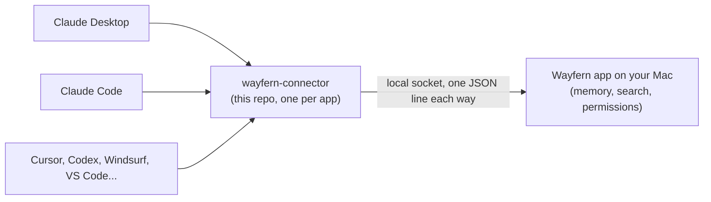

# Wayfern connector

Lets your AI apps share one memory. Claude, Cursor, Codex and the rest each launch this small MCP server, and it
passes their `recall`, `remember` and `forget` calls to the Wayfern app on your Mac. Tell Claude a project decision on Monday
and Cursor knows it on Tuesday.



**Status: early beta, Mac only.** The connector works and is tested, but it needs the Wayfern app running on the same
Mac, and that app is in private beta. Without it every call answers "Wayfern isn't running on this computer".

## Why a connector and not a memory server

Most MCP memory servers keep the memory inside the server, so each app gets its own pile. Here the memory lives in
one place, the Wayfern app, and every app reaches the same one. The connector stores nothing, sends nothing over the
network, and does not decide what an app may see: the app does, per AI app (Cursor can be held to work notes while
Claude sees everything). That keeps this repo small enough to read in a few minutes.

## Install

Check that the Wayfern app answers first:

```bash
npx -y wayfern-connector --check
```

**Claude Desktop:** download `wayfern-connector.mcpb` from the latest release and open it.

**Claude Code:**

```bash
claude mcp add wayfern -- npx -y wayfern-connector
```

or as a plugin: `/plugin marketplace add Hadeva-Dev/wayfern-connector`, then `/plugin install wayfern@wayfern`.

**Cursor, Windsurf, Gemini CLI, VS Code** (each app's MCP config file):

```json
{
  "mcpServers": {
    "wayfern": {
      "command": "npx",
      "args": ["-y", "wayfern-connector"],
      "env": { "WAYFERN_CLIENT": "cursor" }
    }
  }
}
```

**Codex** (`~/.codex/config.toml`):

```toml
[mcp_servers.wayfern]
command = "npx"
args = ["-y", "wayfern-connector"]
env = { WAYFERN_CLIENT = "codex" }
```

Needs Node 18 or later (Claude Desktop brings its own for the `.mcpb`).

## Tools

| tool | what it does |
| --- | --- |
| `recall` | search the memory by meaning and keywords (read only) |
| `remember` | save one fact for future conversations |
| `forget` | retire one memory (it can be restored) |
| `access_status` | say what this app is allowed to see |

## Settings

| variable | default | meaning |
| --- | --- | --- |
| `WAYFERN_CLIENT` | none | a name for the app, shown in Wayfern and used for its permissions |
| `WAYFERN_CLIENT_KEY` | none | a key the Wayfern app gives an app it trusts with more than its default |
| `WAYFERN_SOCKET` | `~/Library/Application Support/Wayfern/connector.sock` | where the Wayfern app listens |
| `WAYFERN_TIMEOUT_MS` | `15000` | how long to wait for an answer |

## Limits

- Mac only, and only with the Wayfern app running. No Windows or Linux app yet.
- Cloud apps (claude.ai, ChatGPT) cannot launch a local server. They will connect to Wayfern's own URL instead, which
  is not live yet.
- An app's name is a label, not a password: any program running as you can talk to the socket. Permissions keep each
  AI app to what suits it; they are not a wall against software you already run.

## How it works

One request per call: a JSON line with the tool, its checked arguments and who is asking, answered by one JSON line.
The full protocol is in [docs/PROTOCOL.md](docs/PROTOCOL.md), and why the repo is shaped this way is in
[docs/DESIGN.md](docs/DESIGN.md). The connector refuses a socket owned by another user.

```bash
npm install
npm test              # builds, then runs the connector against a fake Wayfern app
npm run test:bundle   # the same tests against the .mcpb bundle
npm run pack:mcpb     # builds wayfern-connector.mcpb
```

Developing needs Node 22 or later (for the test runner).

## License

MIT, see [LICENSE](LICENSE).
