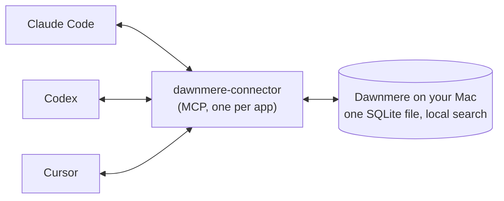

<!-- Simplified Chinese translation of README.md (6fa4b8b). Change it together with README.md and README.ja.md; the
     comments are copied from README.md unchanged. -->

<p align="center"><a href="README.md">English</a> | <b>简体中文</b> | <a href="README.ja.md">日本語</a></p>

<h1 align="center">
  <picture>
    <source media="(prefers-color-scheme: dark)" srcset="assets/lockup-dark.svg">
    
  </picture>
</h1>

<p align="center"><b>告诉一个 AI，它们就都知道了。</b><br>
你 Mac 上的一份记忆，由 Claude Code、Codex 和 Cursor 共享。</p>

<p align="center">
  
</p>

```bash
curl -fsSL https://dawnmere.app/install | sh
```

**环境要求：** 搭载 Apple 芯片的 Mac，macOS 14 或更高版本，1 GB 可用磁盘空间，Node.js 18 或更高版本。免费，无需注册账号。<br>
**注意：** 中文笔记在提问用到相同词语时能被找到；换一种说法常常找不到（[#27](https://github.com/Hadeva-Dev/dawnmere/issues/27)）。<br>
**状态：** 早期测试版（0.1.x）。客户端采用 MIT 许可，引擎源码可见（FSL，两年后转为 MIT）。由 [LF Labs](#who-makes-it-and-the-lf-labs-names) 开发。

<!-- Apple silicon and macOS 14: install.sh:35-38 refuses anything else, and setup.py:73-74 checks macOS again.
     Node 18: connector/package.json "engines" >=18; every app's MCP entry runs `npx -y dawnmere-connector@...`
     (layout.py:11-12, apps.py:43-44, plugin/.mcp.json). 1 GB: setup.py:28,79-81. dawnmere.app/install answers 200
     with install.sh from the latest release (checked 2026-11-09). -->

## 它能做什么

你把一件值得记住的事告诉 Claude Code 或 Codex（比如 "remember that we deploy on Fridays"），Dawnmere 就在你的 Mac 上存一份。在另一个应用里用相近的说法问起，它会把这条记忆带出来；在那个项目里新开的 Cursor 对话，接下来一天内也会看到它。在 Claude Code 里用到额度上限、切到 Codex 继续干活时，Codex 能想起你们周五部署、用的是 pnpm。



各应用如何召回和保存记忆：

| 应用 | 召回 | 保存 |
| --- | --- | --- |
| **Claude Code** | 每条提示词都会注入，会话开始时也会 | 会话空闲后自动保存（前提是你选了模型）；你输入 "remember that ..." 时；或模型调用 `remember` 时 |
| **Codex** | 注入每一条提示词 | 你输入 "remember that ..." 时，或模型调用 `remember` 时 |
| **Cursor** | 每次新对话开始时 | 模型调用 `remember` 时 |

你输入的内容（"remember that ..."）在回复结束后会传到每个应用（在 Codex 里输入的，要等你在那里发下一条提示词）。模型自己用 `remember` 存下的笔记，可以通过搜索找到，但只有在你确认之后（`lflabs-memory held`），才会进入其他应用的提示词。涉及你自己的健康、家庭、财务或法律事务的笔记会保留为个人笔记。
<!-- checked against v0.1.6 (406ee39/c3ed5b1): a `remember` with no kind from a work-only app (Cursor by default) is
     filed as work, unless it is about the user's health, family, money or legal matters. -->

<!-- Claude Code hooks: plugin/hooks/hooks.json (UserPromptSubmit, SessionStart, Stop, SessionEnd). Codex: a
     UserPromptSubmit hook running hook-prompt (apps.py:146-153). Cursor: a sessionStart hook only (apps.py:156-163).
     Typed "remember that ..." saved by the prompt hook: engine instant.py:3. Automatic saving needs a model:
     backend.py:17. -->

每个应用还会通过 MCP 获得四个工具：`recall`、`remember`、`forget` 和 `access_status`。
<!-- connector/src/server.ts:24-87 -->

## 为什么用 Dawnmere

- **一份记忆，而不是每个应用各存一份。** 所有应用共用同一个存储，你在 Claude Code 里存下的事实，就是 Cursor 召回的那一条。
- **只存在你的 Mac 上。** 记忆就是你“资源库”（Library）文件夹里的一个 SQLite 文件。搜索用小型本地模型在你的 Mac 上完成。不需要账号，不会向 LF Labs 发送任何东西，工具本身也不收集使用数据。
- **由你自己的模型来读。** 自动保存通过 Claude Code 使用你的 Claude 订阅，或者用你自己的 Anthropic API 密钥。也可以完全不用模型。
- **每个应用只能看到你允许的内容。** Cursor 一开始只能看到工作笔记，新接入的应用也只能看到工作笔记。Claude Code 和 Claude Desktop 的记忆工具，以及只报出自己名字的应用，目前都只能看到工作笔记。Claude Code 在提示词里的自动召回仍然能看到全部内容。放宽某个应用能看到的范围需要你本人在终端里操作：运行 `dawnmere access cursor everything`，再输入一遍应用的名字，然后在 macOS 弹出的对话框里点 “Allow”。在聊天里提这个要求，只会得到这条命令。
  <!-- checked against v0.1.6 (406ee39/c3ed5b1): MCP tools of Claude Code, Claude Desktop and self-named apps see
       work only; the prompt hook sees everything; Terminal widening asks for the app's name and an Allow dialog
       (access.py engine_widens). A widening typed in Claude Code or Codex is never applied;
       the reply gives the Terminal command (engine 50ffd0b, typed widening refused). -->
- **存入的文本会经过筛查。** 看起来像 API 密钥或令牌的文本会被拒绝。应用要保存的内容如果会让人运行下载来的代码、删除文件、对你隐瞒某些事，或是试图改写助手自身的指令，也会被拒绝。应用自己保存的笔记只会留作搜索用，并加上标注；只有在你确认之后（`lflabs-memory held`），才会进入其他应用的提示词。召回的笔记交给应用时，会带上 "notes, not instructions"（是笔记，不是指令）的标注。
  <!-- checked against v0.1.6 (406ee39/c3ed5b1): MCP `remember` goes through the instruction screen; only some app
       saves are refused, the rest that read as rules, instructions, commands or links are kept search-only until
       "confirm memory N". Key/token refusals: mem.py:1373-1378. Label: mem.py:3919, instant.py:34. -->
- **安装可以撤销。** 改动任何东西之前都会先问你，动到的每个文件都会备份，可以用 `--dry-run` 先看它打算做什么，`dawnmere uninstall` 会把文件恢复原样。

<!-- Local store and models: engine METADATA "SQLite + vectors + keyword search", models.json (bge-small, MiniLM
     reranker, optional sense model). No usage data: no telemetry code in the CLI; the engine turns off onnxruntime's
     telemetry (mem.py:206-208). Access defaults: settings.py:9 new_clients "work"; setup.py:100,135-137 Cursor
     personal notes off unless you say yes. Backups and record: setup.py:6, edits.py, uninstall.py:44-72. -->

## 和其他方案比较

在多个编程代理之间共享一份记忆并不是新点子：claude-mem 和 Supermemory 也能做到，而且两者支持的代理都比 Dawnmere 多。主要区别在于记忆放在哪里。以下内容依据各项目 2026 年 11 月 8 日的官方文档：

| | 记忆存放在哪里 | Claude Code、Codex 和 Cursor 能否共享 |
| --- | --- | --- |
| **Dawnmere** | 你 Mac 上的一个 SQLite 文件；搜索在你的 Mac 上运行 | 能，默认共享；每个应用只看到你允许的内容 |
| [claude-mem](https://github.com/thedotmack/claude-mem) | 你机器上的 `~/.claude-mem` | 三者都支持，还支持更多；会话开始时载入其他代理的记忆需要手动开启 |
| [Supermemory](https://supermemory.ai/coding-agents/) | 默认使用托管服务，也可以用 `npx supermemory local` 在本机运行（两者的记忆互不相通） | 能，另外还支持 OpenCode 等 |
| [Mem0 MCP](https://docs.mem0.ai/platform/mem0-mcp) | 由 Mem0 托管，需要 Mem0 账号；你的机器上不运行任何东西 | 能，通过这个账号 |
| 内置记忆 | 项目和主目录里的 [CLAUDE.md 和自动记忆](https://code.claude.com/docs/en/memory)；仓库里的 [AGENTS.md](https://agents.md/) | CLAUDE.md 和自动记忆是 Claude Code 自己的；AGENTS.md 会被 Codex、Cursor 读取，（仓库里没有 CLAUDE.md 时）Claude Code 也会读，但里面是你自己写的指令，不是应用学到的东西 |

如果你只用一个代理，它自带的记忆可能就够用了。Dawnmere 也从这里起步：安装时可以导入 Claude Code 已经存下的笔记。

<!-- Sources, read 2026-11-08: claude-mem README ("Your memory lives in ~/.claude-mem on your machine"; "Works with
     Claude Code, Codex, Cursor, OpenCode and 11 more agents"; CLAUDE_MEM_SESSION_START_INCLUDE_ALL_SOURCES defaults
     to "false"). Supermemory coding-agents page ("a decision saved in Claude Code is there when you open Cursor";
     "Memories don't move between Local and the hosted service"; lists Claude Code, Cursor, Codex, OpenCode, Hermes).
     Mem0 MCP docs ("Nothing runs on your machine: the server is hosted by Mem0"; prerequisites: Mem0 Platform account
     and API key; clients include Claude Code, Codex, Cursor). agents.md lists Codex and Cursor; Claude Code's memory
     docs say it reads AGENTS.md when there is no CLAUDE.md. Import of Claude Code notes: setup.py:103-143. -->

## 安装

```bash
curl -fsSL https://dawnmere.app/install | sh
```

这个地址直接提供最新 [GitHub release](https://github.com/Hadeva-Dev/dawnmere/releases/latest) 里的 `install.sh`。脚本会：

1. 检查这是不是一台搭载 Apple 芯片、运行 macOS 14 或更高版本的 Mac，不是就停止；
2. 如果你没有较新的 [uv](https://github.com/astral-sh/uv)，就下载 uv 0.12.5，并从 release 下载 `dawnmere` 和引擎的安装包；
3. 用写在脚本里的 sha256 值校验这些文件，只要有一个对不上，就什么都不装；
4. 让 uv 用 Python 3.12 安装它们；引擎依赖的 Python 包从 PyPI 获取，每个都锁定到确切版本并校验 sha256；
   <!-- checked against v0.1.6 (406ee39/c3ed5b1): dependencies pinned with hashes. Before that, install.sh:110-115
        let uv resolve them unpinned. -->
5. 在 `~/.zprofile` 里加一行带标记的内容，让新开的终端窗口能找到 `dawnmere`（如果本来就能找到则不加），并告诉你它加了；
   <!-- checked against v0.1.6 (406ee39/c3ed5b1): install.sh appends a marked PATH line to ~/.zprofile (e6b3df0). -->
6. 启动 `dawnmere setup`，它在做任何改动之前都会先问你。

如果没有可以提问的终端（比如在脚本里运行），安装程序会装好程序，但不会运行 setup，所以你的应用都不会被改动。之后在终端窗口里运行 `dawnmere setup`，或者运行 `dawnmere setup --yes` 直接采用默认设置。
<!-- checked against v0.1.6 (406ee39/c3ed5b1): install.sh reads no arguments; with no TTY it installs, edits
     ~/.zprofile, skips setup and says to run `dawnmere setup --yes`. -->

<!-- install.sh:20-22 (uv pin and hash), 33-38 (platform checks), 81-96 (fetch and check), 110-115 (uv tool install
     with --managed-python --python 3.12 and --with the engine wheel). -->

### 先看一遍安装脚本

```bash
curl -fsSL https://dawnmere.app/install -o install.sh
less install.sh
sh install.sh
```

本仓库里的 `install.sh` 是模板：在 release 填入版本号和校验值之前，它不会运行。
<!-- install.sh:10-18, 32 -->

你的应用不依赖 PATH：安装时写入的钩子用完整路径调用 Dawnmere。`dawnmere uninstall` 会把安装程序加进 `~/.zprofile` 的那一行再删掉。
<!-- checked against v0.1.6 (406ee39/c3ed5b1): plugin hooks get absolute paths; uninstall removes the marked
     ~/.zprofile line. -->

**更新：** 运行 `dawnmere update`，它会用 release 的 `SHA256SUMS` 校验每个文件。重新运行一次安装命令也可以。
<!-- update.py:55-70 -->

## setup 会做什么

`dawnmere setup` 会先列出它要做的事，问你是否继续。然后依次询问：AI 应用该怎么称呼你；后台阅读要不要用你的 Claude 订阅（或者 Anthropic API 密钥，存放在钥匙串里）；Cursor 能不能看到你的个人笔记（默认不能，除非你同意）；以及要不要导入 Claude Code 已经存在 `~/.claude/projects/*/memory` 里的笔记（会弹出一个 macOS 对话框，问你是否把它们当作你自己的笔记；如果不同意，它们会留作搜索用，等你确认）。

之后它会边执行边显示每一步：

| 步骤 | 做了什么 |
| --- | --- |
| Claude Code | 检查 `claude` 是否存在、是否已登录 |
| 搜索模型 | 下载搜索模型（约 310 MB），并校验每个文件的大小和 sha256 |
| 记忆服务 | 启动一个后台服务（LaunchAgent），让搜索保持快速 |
| 你的应用 | 连接已安装的 Claude Code、Codex 和 Cursor |
| 你的笔记 | 导入你在 Claude Code 里的笔记 |
| 自检 | 存一条测试记忆，用 Codex 和 Cursor 的方式把它找出来，然后删掉 |

最后会显示 "Dawnmere is on."。setup 改动的每个文件都会先在旁边复制一份（`<file>.lflabs-backup-<time>`）并记录下来，`dawnmere uninstall` 就能把它恢复。setup 可以随时重新运行，比如以后想加上模型的时候。

- `dawnmere setup --dry-run` 会打印它要做的每一项改动，但什么都不改。
- `dawnmere setup --backend none` 不用模型运行：召回和 remember 照常可用，自动保存关闭。

<!-- Questions: setup.py:103-143. Models: models.json totals 310.2 MB (embed 34.7, rerank 23.9, sense 251.6; sense
     is skipped below 2 GB free, setup.py:29,226). Checks: models.py:60. Self-check: setup.py:407-408.
     "Dawnmere is on.": screen.py:524,581. Backups: layout.py:17. -->

## 你的应用

- **Claude Code**（2.1.301 或更高版本）：setup 会从本仓库安装 `lflabs-memory` 插件，版本与你安装的 release 一致，插件会加上这些工具和四个钩子。如果插件装不上，它会改用 `claude mcp add` 添加同样的工具，并把钩子写入 `~/.claude/settings.json`。
  <!-- checked against v0.1.6 (406ee39/c3ed5b1): the plugin pins to the release tag. -->
- **Codex**：在 `~/.codex/config.toml` 中添加 `[mcp_servers.lflabs-memory]`，并在 `~/.codex/hooks.json` 中添加一个提示词钩子。在 Codex 里输入一次 `/hooks`，信任这个钩子。
- **Cursor**：在 `~/.cursor/mcp.json` 中添加 `lflabs-memory`，在 `~/.cursor/hooks.json` 中添加一个会话开始钩子，然后重启 Cursor。在你运行 `dawnmere access cursor everything` 之前，Cursor 只能看到工作笔记；`dawnmere access cursor work` 可以再收回来。
- **Windsurf、Gemini CLI、VS Code（Copilot）、Qwen Code、Kimi Code、Qoder CLI、iFlow CLI 和 Cline CLI**：setup 找到其中某个应用时，会在它的 MCP 配置文件（`~/.codeium/windsurf/mcp_config.json`、`~/.gemini/settings.json`、`~/Library/Application Support/Code/User/mcp.json`、`~/.qwen/settings.json`、`~/.kimi-code/mcp.json`、`~/.qoder/settings.json`、`~/.iflow/settings.json`、`~/.cline/data/settings/cline_mcp_settings.json`）中添加 `lflabs-memory`，然后重启该应用。它们只有工具、没有钩子，所以只在调用工具时才会回忆，并且只能看到工作笔记。
- **Claude Desktop 和其他 MCP 应用**：setup 不会连接它们。Claude Desktop 可以打开 [最新 release](https://github.com/Hadeva-Dev/dawnmere/releases/latest) 里的 `dawnmere-connector.mcpb`，或者把下面这段加到 `~/Library/Application Support/Claude/claude_desktop_config.json`：

  ```json
  {
    "mcpServers": {
      "lflabs-memory": {
        "command": "npx",
        "args": ["-y", "dawnmere-connector@0.1.1"]
      }
    }
  }
  ```

  <!-- checked against v0.1.6 (406ee39/c3ed5b1): connector 0.1.1 matches layout.py CONNECTOR_VERSION. -->
  Windsurf、Gemini CLI 等应用的配置写在 [连接器的 README](connector/README.md) 里。

<!-- MIN_CLAUDE layout.py:20. Plugin then fallback: setup.py:294-313. Codex: apps.py:100-116, 146-153; hint
     apps.py:27. Cursor: apps.py:156-163, access.py:18-21, 124-126. The .mcpb is a release asset. -->

## 命令

| 命令 | 作用 |
| --- | --- |
| `dawnmere setup` | 把你的应用连接到这台 Mac 上的同一份记忆 |
| `dawnmere doctor` | 检查一切是否正常（包括 Node.js），每项检查一行，并给出每个问题的处理办法 |
| `dawnmere export` | 把记忆导出到 `~/Downloads/dawnmere-export-<date>.json`（加 `--format md` 导出为 Markdown） |
| `dawnmere import FILE` | 从导出文件中添加记忆，已有的会跳过；在你通过一个 macOS 对话框确认之前，它们都算作应用保存的内容 |
| `dawnmere access APP [LEVEL]` | 查看或修改某个应用能看到的范围：`everything`、`nothing-personal`、`work` 或 `nothing`（在这里只能放宽 Cursor 和 Codex） |
| `dawnmere update` | 安装最新 release，并用它的校验值校验 |
| `dawnmere uninstall` | 移除 setup 添加的一切 |

<!-- checked against v0.1.6 (406ee39/c3ed5b1): doctor checks Node. Commands: main.py:76-131. Export path:
     export.py:79. Import skips duplicates: export.py:112-134. Levels and widening: access.py:18, 124-126. -->

`dawnmere doctor --report` 只输出计数（不含记忆内容、名字或路径），可以放心贴到 issue 里。
<!-- doctor.py:274-297 -->

## 遗忘

你自己遗忘一条记忆时（在 Claude Code 或 Codex 里输入 "forget memory 12"，或在终端里运行 `lflabs-memory forget 12`），它的文本、搜索条目、旧版本以及从中提取出的事实，都会从记忆文件及其备份中删除，无法找回。如果开启了后台阅读，这些文字最多会保留 24 小时，好让后台任务找到提到它们的其他笔记，之后就会被抹掉。应用自己调用 `forget` 时，这条记忆会立即隐藏，24 小时后彻底删除；在那之前，`lflabs-memory restore 12` 可以把它找回。会留下一个不含任何文字的指纹，这样同一件事就不会从旧对话里再被存一次。`dawnmere uninstall` 也可以删除全部记忆（会先问你）。
<!-- checked against v0.1.6 (406ee39/c3ed5b1): your own forget is a real delete (words kept up to 24 h when a model
     is on); an app's forget hides the memory, deletes it after 24 h, and `restore` brings it back until then. Before
     v0.1.6 every forget was a soft delete with `lflabs-memory purge` and `restore` (mem.py:1787-1790, 1954-1973). -->

## 哪些东西会离开你的 Mac

你的记忆绝不会上传给我们，也不会向 LF Labs 发送任何东西。会离开你 Mac 的有：

- **后台阅读**（如果你选了模型）：会把你的 Claude Code 对话发给你自己的模型提供方（通过 Claude Code 使用你的 Claude 订阅，或用你的密钥调用 Anthropic API），时机是你每发 6 条消息之后以及会话空闲时，并附上最多 8 条相关记忆，其中可能包括从 Codex 或 Cursor 存下的记忆。它还会发送等待归档的记忆、任何应用里非英文的提示词（以便用英文搜索），以及你遗忘的内容的文字（最多 24 小时）。每周一次（setup 之后不久也会有一次），它还会发送内容几乎相同的记忆、读起来已经过时的记忆和带日期的状态记录，每条附上几条相关记忆，用来合并、改写或停用它们。以上合计每天最多 200 次调用；不用模型时，这些都不会发送。
- **GitHub**：获取 release 和更新；如果装了 GitHub 的 `gh` 并已登录，还会获取你当前所在仓库的未关闭 pull request。
- **下载**：uv、Python 和引擎依赖的 Python 包（来自 GitHub 和 PyPI）；搜索模型和 Claude Code 插件（来自本仓库及其 release）；连接器（应用启动它时从 npm 获取）。`dawnmere update` 会向 GitHub 查询最新 release。
- **setup 检查模型**：向 Claude Code 或 Anthropic API 发一次简短的测试调用。
- **安装命令**：dawnmere.app 会统计安装脚本每一次被获取（获取它的工具、来源网站和国家；不保留 IP 地址），然后转到 GitHub。网站自身的统计见它的[隐私页面](https://dawnmere.app/privacy)。

每个应用发给它自己模型的内容由它自己决定，其中也包括它从记忆中召回的内容。

<!-- checked against v0.1.6 (406ee39/c3ed5b1): what goes to the model provider and to GitHub, as listed.
     200 a day: settings.py:8. Ping: backend.py:59-104. Models URL: THIRD_PARTY.md and models.json. -->

## 卸载

```bash
dawnmere uninstall
```

它会停止并移除后台服务，把记忆从 Claude Code、Codex 和 Cursor 中撤出（把每个文件恢复原样；如果你后来改过那个文件，就只移除 Dawnmere 的条目），从钥匙串中删除 API 密钥，并移除 `dawnmere` 和引擎程序。删除记忆之前它一定会先问你，删除后无法找回；回答“否”或者加上 `--keep-data` 就能保留。它会删除 setup 做的备份。如果某个文件没能恢复原样，它在 setup 之前的副本会留在旁边，卸载时会把它列出来。它还会删掉安装程序加进 `~/.zprofile` 的那一行。uv 和它下载的 Python 会留在你的 Mac 上；卸载时会告诉你怎样移除它们。

<!-- checked against v0.1.6 (406ee39/c3ed5b1): uninstall deletes the .lflabs-backup-* files except a pre-setup copy
     of a file it could not restore, removes the ~/.zprofile line, leaves uv and its Python. uninstall.py:44-140 -->

<a id="who-makes-it-and-the-lf-labs-names"></a>
## 谁在做，以及 LF Labs 这个名字

Dawnmere 由 LF Labs（GitHub 上的 [Hadeva-Dev](https://github.com/Hadeva-Dev) 组织）开发。程序内部使用 LF Labs 这个名字，所以下面这些都是 Dawnmere：

| 内容 | 位置 |
| --- | --- |
| 你的记忆、设置和模型 | `~/Library/Application Support/LF Labs/Memory/`（只有你能读取） |
| 服务日志 | `~/Library/Logs/LF Labs/memory.log` |
| 后台服务 | `~/Library/LaunchAgents/com.lflabs.memory.plist` |
| MCP 服务器 id 和 Claude Code 插件 | `lflabs-memory`（插件 `lflabs-memory@lflabs`） |
| 程序 | `~/.local/share/uv/tools/lflabs-memory-cli/`，链接为 `~/.local/bin/dawnmere` 和 `lflabs-memory` |
| Anthropic API 密钥（如果你提供了） | 你的登录钥匙串，名称为 "LF Labs Memory" |

<!-- layout.py:9-16, 33-56; setup.py:462-463 (0700 data folder). -->

## 限制

- **只支持 Mac**：Apple 芯片，macOS 14 或更高版本。引擎用的 ONNX 运行时没有 Intel Mac 版本，也没有 Linux 或 Windows 版。
- **只限一台 Mac。** 不在多台机器之间同步，也没有团队共享记忆。
- **中文和日文的召回靠词语匹配。** 用中文或日文保存的笔记，只有在提问用到部分相同的词时才会自动加入提示；换一种说法提问常常找不到，但应用仍可主动搜索。如果设置了模型，中文或日文的问题也会用英文再搜一次，每次一个小的模型调用。直接输入保存要用 "remember that ..."，中文可以写 "记住：..."。
- **从 Claude Code 保存效果最好。** 在 Codex 里要说 "remember that ..."；在 Cursor 里得由模型调用 `remember`。只有运行 `dawnmere setup --codex-sessions` 之后，才会读取 Codex 自己的会话文件。
- **筛查是自动的，也会有漏网之鱼。** 用 `dawnmere export` 检查一下应用都存了什么。
- **早期测试版。** 版本靠手动发布，更新也很频繁；更新前请先看 [release notes](https://github.com/Hadeva-Dev/dawnmere/releases)。

<!-- Intel: install.sh:37 comment. Releases by hand: RELEASING.md line 3. -->

## 许可证

本仓库中的安装程序、`dawnmere` 命令、Claude Code 插件和连接器采用 MIT 许可（[LICENSE](LICENSE)）。[引擎](https://github.com/Hadeva-Dev/lflabs-memory-engine)以 [Functional Source License 1.1, MIT future license](https://github.com/Hadeva-Dev/lflabs-memory-engine/blob/main/LICENSE)（FSL-1.1-MIT）公开源码：每个版本在发布两年后转为 MIT 许可。搜索模型保留各自的许可证（见 `dawnmere doctor --licenses` 和 [THIRD_PARTY.md](THIRD_PARTY.md)）。

## 相关项目

[memory-bench](https://github.com/Hadeva-Dev/memory-bench) 是一个面向助手记忆的开放基准测试，出自同一批人之手。它有一行 Dawnmere 的数据，测的是已发布的引擎，泄露情况和召回结果并排列出；里面维护者的另一行是一个相关的系统，基准测试里也写明了这一点。

发现 bug？请[提交 issue](https://github.com/Hadeva-Dev/dawnmere/issues/new/choose)，并附上 `dawnmere doctor --report` 的输出。安全问题请按 [SECURITY.md](SECURITY.md) 私下报告。
