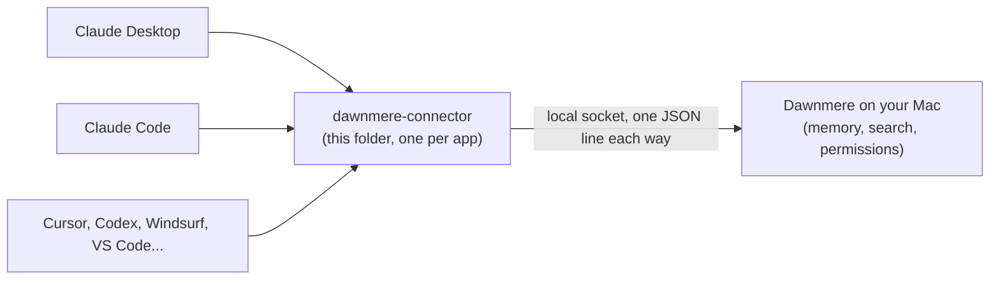

# Dawnmere connector

Lets your AI apps share one memory. Claude, Cursor, Codex and the rest each launch this small MCP server, and it
passes their `recall`, `remember` and `forget` calls to Dawnmere on your Mac. Tell Claude a project decision on Monday
and Cursor knows it on Tuesday.



**Status: early beta, Mac only.** The connector is the small piece each AI app launches; Dawnmere itself installs with
one line (see the [repo's README](https://github.com/Hadeva-Dev/dawnmere#readme)) and runs in the background on the same Mac. Without it every call
answers "Dawnmere isn't running on this computer". The package and settings names below are neutral and will not
change if the product name does.

## Why a connector and not a memory server

Most MCP memory servers keep the memory inside the server, so each app gets its own pile. Here the memory lives in
one place, Dawnmere, and every app reaches the same one. The connector stores nothing, sends nothing over the
network, and does not decide what an app may see: Dawnmere does, per AI app (Cursor can be held to work notes while
Claude sees everything). That keeps this folder small enough to read in a few minutes.

## Install

Check that Dawnmere answers first:

```bash
npx -y dawnmere-connector --check
```

**Claude Desktop:** download `dawnmere-connector.mcpb` from the latest release and open it.

**Claude Code:**

```bash
claude mcp add --scope user dawnmere -- npx -y dawnmere-connector
```

or as a plugin: `/plugin marketplace add Hadeva-Dev/dawnmere`, then `/plugin install dawnmere@dawnmere`.

**Cursor, Windsurf, Gemini CLI** (`~/.cursor/mcp.json`, `~/.codeium/windsurf/mcp_config.json`,
`~/.gemini/settings.json`):

```json
{
  "mcpServers": {
    "dawnmere": {
      "command": "npx",
      "args": ["-y", "dawnmere-connector"],
      "env": { "LFLABS_MEMORY_CLIENT": "cursor" }
    }
  }
}
```

Set `LFLABS_MEMORY_CLIENT` to the app it is in: `cursor`, `windsurf` or `gemini`. The name decides what that app may
see, so do not copy Cursor's into another app.

**VS Code** (the user `mcp.json`: run "MCP: Open User Configuration" from the Command Palette):

```json
{
  "servers": {
    "dawnmere": {
      "type": "stdio",
      "command": "npx",
      "args": ["-y", "dawnmere-connector"],
      "env": { "LFLABS_MEMORY_CLIENT": "copilot" }
    }
  }
}
```

**Codex** (`~/.codex/config.toml`):

```toml
[mcp_servers.dawnmere]
command = "npx"
args = ["-y", "dawnmere-connector"]
env = { LFLABS_MEMORY_CLIENT = "codex" }
```

Needs Node 18 or later (Claude Desktop brings its own for the `.mcpb`).

## Tools

| tool | what it does |
| --- | --- |
| `recall` | search the memory by meaning and keywords (read only) |
| `remember` | save one fact for future conversations |
| `forget` | retire one memory (it can be restored) |
| `access_status` | say what this app is allowed to see |

## Settings

| variable | default | meaning |
| --- | --- | --- |
| `LFLABS_MEMORY_CLIENT` | none | a name for the app, shown in Dawnmere and used for its permissions |
| `LFLABS_MEMORY_CLIENT_KEY` | none | a key Dawnmere gives an app it trusts with more than its default |
| `LFLABS_MEMORY_SOCKET` | `~/Library/Application Support/LF Labs/memory-connector.sock` | where Dawnmere listens |
| `LFLABS_MEMORY_TIMEOUT_MS` | `20000` | how long to wait for an answer |

## Limits

- Mac only, and only with Dawnmere running. No Windows or Linux app yet.
- An app's name is a label, not a password: any program running as you can talk to the socket. Permissions keep each
  AI app to what suits it; they are not a wall against software you already run.

## How it works

One request per call: a JSON line with the tool, its checked arguments and who is asking, answered by one JSON line.
The full protocol is in [docs/PROTOCOL.md](docs/PROTOCOL.md), and why the repo is shaped this way is in
[docs/DESIGN.md](docs/DESIGN.md). The connector refuses a socket owned by another user.

```bash
npm install
npm test              # builds, then runs the connector against a fake memory app
npm run test:bundle   # the same tests against the .mcpb bundle
npm run pack:mcpb     # builds dawnmere-connector.mcpb
```

Developing needs Node 22 or later (for the test runner).

## License

MIT, see [LICENSE](LICENSE).
